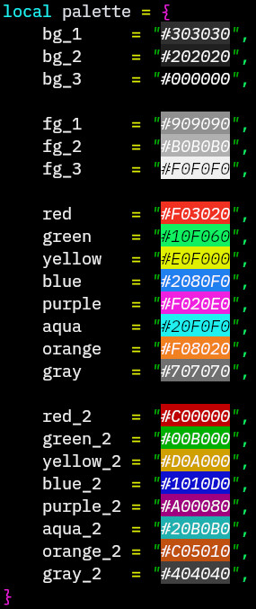

# pearly.nvim

Custom neovim colorscheme inspired by built in **murphy**.

## Features

Besides default syntax highlighting other third-party plugins are supported.
These are some of them worth mentioning. More detailed list will be added later.

- StatusLine
- TODO
- NeoTree (beta)
- Basic syntax

_I plan to add better syntax highlighting with lsp support_

### Color palette HEX values

---

__`pearly.nvim` is still in developement. I do not advice using it yet!__
